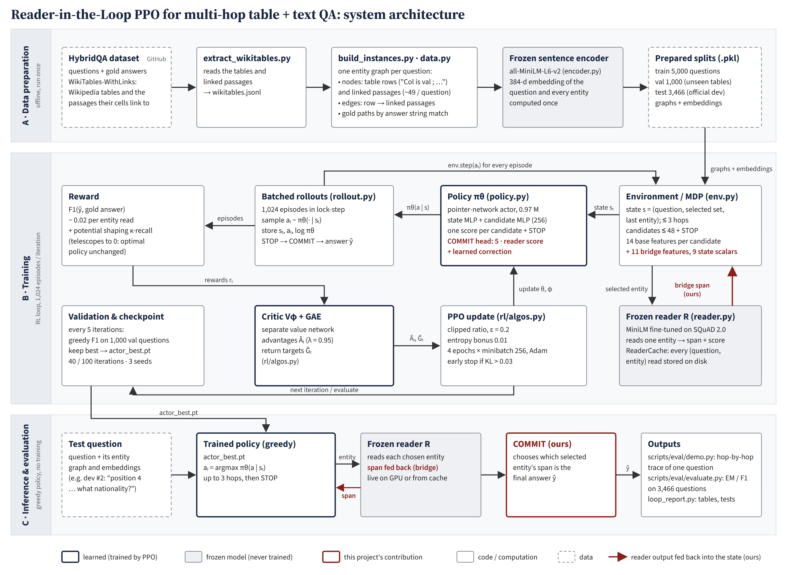

# Multi-Hop Table Reasoning through Reinforcement Learning

CS769 (Optimization in Machine Learning) course project, IIT Bombay.
Aakash Gupta (23B0953) and Aditi Singh (23B1053). TA: Jahanvi Rajput.

Multi-hop questions over Wikipedia tables and their linked passages (HybridQA) need a chain of
evidence, for example "find the row with Pos = 4, then follow the link to the driver's page". We train
a pointer-network policy with PPO to choose **which table row or passage to read next and when to
stop**, while a frozen extractive reader answers from the chosen evidence.

**Reader-in-the-Loop PPO (RiL-PPO)** is our extension. It feeds the reader's answer back into the
policy's state ("bridge feedback"), and it adds a learned **COMMIT** action that chooses which selected
entity supplies the final answer.



## Results (HybridQA dev set, 3,466 questions, same frozen reader for every selector)

| Selector | EM | F1 |
|---|---|---|
| BM25 top-3 (best fixed rule) | 15.9 | 20.8 |
| PPO, 100 iterations (3 seeds) | 22.8 | 28.0 |
| **RiL-PPO, 100 iterations (ours, 3 seeds)** | **31.0** | **37.5** |
| Oracle gold evidence (upper bound) | 48.4 | 55.6 |

RiL-PPO gains +9.5 F1 over PPO with the same training budget (95% CI [8.6, 10.6], p < 0.001). The gain
holds on tables unseen in training and with a different reader (RoBERTa). The full tables, ablations
and significance tests are in [results/loop/REPORT.md](results/loop/REPORT.md).

## Repository layout

```
src/mhtrl/            library: data → entity graphs, environment (MDP), policy, reader, rollouts
  rl/algos.py         PPO, GRPO, RLOO, REINFORCE and the RiL-PPO extensions
configs/
  baseline/           first experiment suite (PPO, BC, REINFORCE, GRPO, reward/GAE ablations)
  ril_ppo/            Reader-in-the-Loop PPO suite (core, extensions, optimisers, long runs)
scripts/
  data/               download → extract tables → build per-question graphs and embeddings
  train/              train one config; run the baseline suite or the RiL-PPO suite
  eval/               evaluate checkpoints; demo.py = inference on one question
  analysis/           aggregate results, report tables/figures, results/loop/REPORT.md
  gpu/                one-command runs for Kaggle / Colab / a lab GPU
  common.py           shared paths and helpers
tests/test_core.py    17 unit tests (CPU and CUDA)
results/              baselines, every run's metrics and logs (checkpoints *.pt are not committed)
report/               LaTeX report (report/main.pdf)
slides/
  final/              final presentation (PDF, PPTX with speaker notes, HTML source, figures)
  progress/           progress-evaluation presentation
  architecture/       system architecture diagram
```

## Setup

Use Python 3.10–3.12 on Linux or WSL. A CUDA GPU is recommended; a 4 GB laptop GPU is enough.

```bash
python -m venv .venv && source .venv/bin/activate
pip install -r requirements.txt          # use a CUDA build of torch on a GPU machine
python tests/test_core.py                # 17 unit tests
```

## Running

```bash
# 1. Data: download HybridQA, extract tables, build graphs (about 10-20 min)
git clone --depth 1 https://github.com/wenhuchen/HybridQA data/raw/HybridQA
git clone --depth 1 --no-checkout https://github.com/wenhuchen/WikiTables-WithLinks data/raw/WikiTables-WithLinks
python scripts/data/extract_wikitables.py
python scripts/data/build_instances.py --n_train 10000 --n_val 1000

# 2. Train a single configuration
python scripts/train/train.py --config configs/ril_ppo/loop_full_long.yaml --seed 0

# 3. Full experiment suites (resumable; data preparation included)
SMOKE=1 bash scripts/gpu/run_loop_gpu.sh   # quick end-to-end check
bash scripts/gpu/run_loop_gpu.sh           # RiL-PPO suite: 48 runs, about 4 h on an RTX 3050 / T4
bash scripts/gpu/run_all_gpu.sh            # first (baseline) suite

# 4. Evaluation and inference
python scripts/eval/evaluate.py --runs results/loop/runs/loop_full_long_s0 --split test
python scripts/eval/demo.py --idx 2 --fresh   # one question, hop by hop, reader running live

# 5. Report
python scripts/analysis/loop_report.py     # results/loop/REPORT.md
```

For Kaggle or Colab, build a small code bundle with `python scripts/gpu/make_gpu_bundle.py`. Upload
`gpu_bundle.zip`, unzip it, and run `bash scripts/gpu/run_loop_gpu.sh`.
