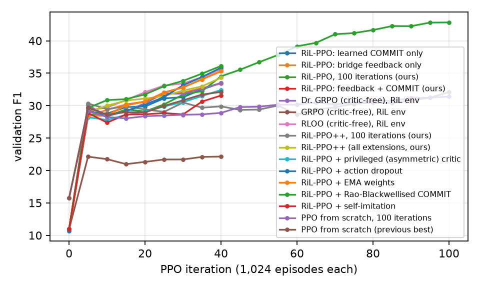

# Reader-in-the-loop PPO (RiL-PPO): results

HybridQA dev set, same frozen reader (MiniLM-SQuAD2) for every selector. Learned methods: mean ± std over seeds (n = number of seeds). `F1 (max-conf)` = the reader's max-confidence rule applied to the same selected set; `F1 (best-in-set)` = an oracle arbiter on that set. The gap AnsRecall → best-in-set is reader error; best-in-set → F1 is aggregation error.

## Main table

| Selector | n | EM | F1 | F1 (max-conf) | F1 (best-in-set) | Ans. in evidence | F1 table | F1 passage | Entities | Words |
|---|---|---|---|---|---|---|---|---|---|---|
| Oracle gold path (upper bound) | 1 | 48.4 | 55.6 | 55.6 | 75.5 | 96.9 | 78.6 | 42.9 | 1.58 | 135 |
| Read every entity (~49 reads, max confidence) | 1 | 17.0 | 21.5 | 21.5 | 80.9 | 97.1 | 18.7 | 24.2 | 49.04 | 5564 |
| BM25 top-3 (best fixed heuristic) | 1 | 15.9 | 20.8 | 20.8 | 32.6 | 37.7 | 21.7 | 20.9 | 3.00 | 333 |
| Hybrid top-3 | 1 | 14.9 | 19.7 | 19.7 | 32.2 | 37.6 | 22.1 | 18.9 | 3.00 | 297 |
| Greedy rank-then-hop (HYBRIDER-style) | 1 | 12.9 | 17.4 | 17.4 | 26.1 | 30.5 | 21.2 | 15.7 | 2.00 | 184 |
| Bridge hop (hand-written reader-in-the-loop rule) | 1 | 14.3 | 19.0 | 19.0 | 31.0 | 37.6 | 22.0 | 17.7 | 2.00 | 195 |
| PPO from scratch (previous best) | 3 | 22.2 ± 1.0 | 27.6 ± 1.0 | 27.6 ± 1.0 | 38.7 ± 2.4 | 46.1 ± 2.8 | 31.6 ± 2.7 | 26.0 ± 0.3 | 2.54 | 338 |
| RiL-PPO: bridge feedback only | 3 | 23.2 ± 0.4 | 28.7 ± 0.5 | 28.7 ± 0.5 | 39.8 ± 1.0 | 48.1 ± 1.4 | 34.0 ± 1.5 | 26.3 ± 1.8 | 2.30 | 293 |
| RiL-PPO: learned COMMIT only | 3 | 23.4 ± 0.3 | 29.0 ± 0.3 | 27.9 ± 0.3 | 42.5 ± 1.0 | 50.9 ± 1.5 | 33.8 ± 1.5 | 27.0 ± 0.7 | 2.83 | 341 |
| **RiL-PPO: feedback + COMMIT (ours)** | 3 | 24.0 ± 1.5 | 29.9 ± 1.6 | 28.3 ± 0.8 | 42.6 ± 2.7 | 51.5 ± 3.0 | 32.1 ± 4.7 | 29.6 ± 0.9 | 2.64 | 323 |
| RiL-PPO + Rao-Blackwellised COMMIT | 3 | 23.9 ± 1.2 | 30.1 ± 1.2 | 28.0 ± 0.2 | 44.7 ± 1.8 | 54.1 ± 2.2 | 30.6 ± 0.8 | 30.8 ± 1.4 | 2.83 | 322 |
| RiL-PPO + privileged (asymmetric) critic | 3 | 21.0 ± 1.4 | 26.6 ± 1.5 | 26.0 ± 1.2 | 35.0 ± 2.7 | 42.2 ± 3.5 | 26.5 ± 2.9 | 27.6 ± 0.7 | 2.22 | 281 |
| RiL-PPO + self-imitation | 3 | 20.8 ± 1.5 | 26.5 ± 1.6 | 25.5 ± 1.2 | 38.0 ± 3.0 | 45.8 ± 3.8 | 28.4 ± 3.2 | 26.2 ± 0.7 | 2.59 | 283 |
| RiL-PPO + action dropout | 3 | 24.8 ± 2.3 | 31.1 ± 2.6 | 29.1 ± 1.4 | 45.3 ± 3.6 | 55.0 ± 4.3 | 33.0 ± 3.4 | 31.1 ± 2.2 | 2.73 | 324 |
| RiL-PPO + EMA weights | 3 | 24.0 ± 1.5 | 29.9 ± 1.6 | 28.3 ± 0.8 | 42.6 ± 2.7 | 51.5 ± 3.0 | 32.1 ± 4.7 | 29.6 ± 0.9 | 2.64 | 323 |
| **RiL-PPO++ (all extensions, ours)** | 3 | 22.8 ± 1.6 | 28.5 ± 1.9 | 26.9 ± 1.7 | 41.4 ± 3.2 | 50.0 ± 3.9 | 31.5 ± 3.4 | 27.5 ± 1.1 | 2.64 | 290 |
| GRPO (critic-free), RiL env | 3 | 13.3 ± 0.5 | 17.7 ± 0.5 | 17.7 ± 0.5 | 17.7 ± 0.5 | 21.6 ± 0.9 | 16.0 ± 0.7 | 19.5 ± 1.3 | 1.00 | 145 |
| Dr. GRPO (critic-free), RiL env | 3 | 22.6 ± 0.9 | 28.4 ± 1.0 | 28.3 ± 1.1 | 42.0 ± 3.8 | 50.5 ± 4.8 | 30.5 ± 2.2 | 28.0 ± 0.3 | 2.68 | 323 |
| RLOO (critic-free), RiL env | 3 | 24.4 ± 1.5 | 30.2 ± 1.6 | 29.3 ± 1.0 | 43.7 ± 2.1 | 53.1 ± 2.1 | 33.9 ± 3.0 | 28.9 ± 0.9 | 2.65 | 315 |
| PPO from scratch, 100 iterations | 3 | 22.8 ± 1.0 | 28.0 ± 1.2 | 28.0 ± 1.2 | 37.9 ± 2.0 | 45.3 ± 2.7 | 33.8 ± 1.9 | 25.1 ± 1.1 | 2.22 | 286 |
| **RiL-PPO, 100 iterations (ours)** | 3 | 31.0 ± 1.4 | 37.5 ± 1.8 | 29.5 ± 1.3 | 47.4 ± 3.0 | 57.4 ± 3.6 | 44.1 ± 0.9 | 34.6 ± 3.0 | 2.63 | 287 |
| **RiL-PPO++, 100 iterations (ours)** | 3 | 21.5 ± 1.6 | 27.0 ± 1.5 | 25.1 ± 0.2 | 35.3 ± 2.2 | 42.4 ± 3.1 | 29.6 ± 5.8 | 26.2 ± 1.3 | 2.40 | 296 |

## Significance (paired bootstrap over questions, 10,000 resamples)

| A − B | ΔF1 | 95% CI | p (one-sided) | P(run A > run B) |
|---|---|---|---|---|
| loop_full − ppo_scratch | +2.26 | [1.48, 3.04] | < 0.001 | 0.89 |
| loop_full − bm25_k3 | +9.12 | [7.99, 10.26] | < 0.001 | 1.00 |
| loop_full − bridge_hop | +10.94 | [9.55, 12.33] | < 0.001 | 1.00 |
| loop_full − greedy_hop | +12.49 | [11.14, 13.82] | < 0.001 | 1.00 |
| loop_full − read_all | +8.39 | [7.10, 9.65] | < 0.001 | 1.00 |
| loop_feedback − ppo_scratch | +1.09 | [0.39, 1.79] | 0.002 | 0.78 |
| loop_commit − ppo_scratch | +1.41 | [0.67, 2.17] | < 0.001 | 0.89 |
| loop_full − loop_feedback | +1.17 | [0.43, 1.90] | 0.001 | 0.67 |
| loop_full − loop_commit | +0.85 | [0.17, 1.53] | 0.008 | 0.67 |
| bridge_hop − greedy_hop | +1.55 | [0.92, 2.20] | < 0.001 | 1.00 |
| plus_all − loop_full | -1.40 | [-2.12, -0.69] | 1.000 | 0.33 |
| plus_all − ppo_scratch | +0.86 | [-0.02, 1.71] | 0.027 | 0.56 |
| plus_all − bm25_k3 | +7.72 | [6.50, 8.90] | < 0.001 | 1.00 |
| plus_rb − loop_full | +0.16 | [-0.52, 0.85] | 0.317 | 0.56 |
| plus_asym − loop_full | -3.31 | [-4.00, -2.63] | 1.000 | 0.11 |
| plus_sil − loop_full | -3.42 | [-4.13, -2.70] | 1.000 | 0.00 |
| plus_drop − loop_full | +1.24 | [0.58, 1.89] | < 0.001 | 0.56 |
| plus_ema − loop_full | +0.00 | [0.00, 0.00] | 1.000 | 0.33 |
| loop_full − opt_rloo | -0.34 | [-1.01, 0.35] | 0.828 | 0.44 |
| opt_rloo − opt_grpo | +12.54 | [11.51, 13.59] | < 0.001 | 1.00 |
| opt_drgrpo − opt_grpo | +10.66 | [9.66, 11.69] | < 0.001 | 1.00 |
| loop_full_long − ppo_scratch_long | +9.55 | [8.56, 10.58] | < 0.001 | 1.00 |
| loop_full_long − bm25_k3 | +16.74 | [15.36, 18.13] | < 0.001 | 1.00 |
| plus_all_long − ppo_scratch_long | -1.01 | [-1.80, -0.22] | 0.994 | 0.33 |
| plus_all_long − loop_full_long | -10.56 | [-11.50, -9.64] | 1.000 | 0.00 |

## Where the gain comes from

| Selector | Ans. in evidence | Best-in-set F1 | Max-conf F1 | Final F1 | Arbitration gain (F1 − max-conf) | Answer changed by COMMIT (%) |
|---|---|---|---|---|---|---|
| PPO from scratch (previous best) | 46.1 | 38.7 | 27.6 | 27.6 | +0.0 | 0.0 |
| RiL-PPO: bridge feedback only | 48.1 | 39.8 | 28.7 | 28.7 | +0.0 | 0.0 |
| RiL-PPO: learned COMMIT only | 50.9 | 42.5 | 27.9 | 29.0 | +1.1 | 15.6 |
| **RiL-PPO: feedback + COMMIT (ours)** | 51.5 | 42.6 | 28.3 | 29.9 | +1.6 | 15.9 |
| RiL-PPO + Rao-Blackwellised COMMIT | 54.1 | 44.7 | 28.0 | 30.1 | +2.1 | 26.9 |
| **RiL-PPO++ (all extensions, ours)** | 50.0 | 41.4 | 26.9 | 28.5 | +1.6 | 24.8 |
| PPO from scratch, 100 iterations | 45.3 | 37.9 | 28.0 | 28.0 | +0.0 | 0.0 |
| **RiL-PPO, 100 iterations (ours)** | 57.4 | 47.4 | 29.5 | 37.5 | +8.0 | 33.5 |
| **RiL-PPO++, 100 iterations (ours)** | 42.4 | 35.3 | 25.1 | 27.0 | +1.8 | 20.4 |

## Tables never seen in training (303 dev questions excluded)

| Selector | F1 (unseen tables) |
|---|---|
| Oracle gold path (upper bound) | 55.8 |
| Read every entity (~49 reads, max confidence) | 21.5 |
| BM25 top-3 (best fixed heuristic) | 20.6 |
| Hybrid top-3 | 19.4 |
| Greedy rank-then-hop (HYBRIDER-style) | 17.4 |
| Bridge hop (hand-written reader-in-the-loop rule) | 18.8 |
| PPO from scratch (previous best) | 27.5 ± 1.0 |
| RiL-PPO: bridge feedback only | 28.5 ± 0.5 |
| RiL-PPO: learned COMMIT only | 28.7 ± 0.4 |
| **RiL-PPO: feedback + COMMIT (ours)** | 29.6 ± 1.7 |
| RiL-PPO + Rao-Blackwellised COMMIT | 29.8 ± 1.1 |
| RiL-PPO + privileged (asymmetric) critic | 26.4 ± 1.5 |
| RiL-PPO + self-imitation | 26.4 ± 1.7 |
| RiL-PPO + action dropout | 30.9 ± 2.5 |
| RiL-PPO + EMA weights | 29.6 ± 1.7 |
| **RiL-PPO++ (all extensions, ours)** | 28.3 ± 2.0 |
| GRPO (critic-free), RiL env | 17.7 ± 0.7 |
| Dr. GRPO (critic-free), RiL env | 28.1 ± 1.1 |
| RLOO (critic-free), RiL env | 30.0 ± 1.5 |
| PPO from scratch, 100 iterations | 27.8 ± 1.2 |
| **RiL-PPO, 100 iterations (ours)** | 37.4 ± 1.9 |
| **RiL-PPO++, 100 iterations (ours)** | 26.6 ± 1.5 |

## Test-time self-consistency over evidence paths

Greedy episode + (k−1) sampled episodes; majority vote over normalised answers. `Reads` = distinct entities read per question (reader cost).

| Selector | k | F1 greedy | F1 voted | Δ | Reads / question |
|---|---|---|---|---|---|
| **RiL-PPO: feedback + COMMIT (ours)** | 8 | 29.9 ± 1.6 | 30.1 ± 1.4 | +0.2 | 5.6 |
| **RiL-PPO++ (all extensions, ours)** | 8 | 28.5 ± 1.9 | 28.3 ± 1.8 | -0.2 | 7.4 |
| PPO from scratch (previous best) | 8 | 27.6 ± 1.0 | 27.8 ± 1.2 | +0.2 | 5.0 |

## Optimisation diagnostics (training logs, mean over the last 10 iterations)

| Method | train answer F1 | critic expl. var. | KL / update | clip frac. | entropy | zero-adv. groups | entities | best iterate | EMA chosen |
|---|---|---|---|---|---|---|---|---|---|
| PPO from scratch (previous best) | 0.326 | 0.47 | 0.0028 | 0.033 | 1.27 | – | 2.60 | 38 | 0/3 |
| RiL-PPO: bridge feedback only | 0.332 | 0.46 | 0.0031 | 0.037 | 1.31 | – | 2.46 | 40 | 0/3 |
| RiL-PPO: learned COMMIT only | 0.347 | 0.48 | 0.0027 | 0.031 | 1.09 | – | 2.85 | 40 | 0/3 |
| **RiL-PPO: feedback + COMMIT (ours)** | 0.344 | 0.48 | 0.0028 | 0.034 | 1.14 | – | 2.71 | 40 | 0/3 |
| RiL-PPO + Rao-Blackwellised COMMIT | 0.352 | 0.57 | 0.0030 | 0.034 | 1.17 | – | 2.86 | 40 | 0/3 |
| RiL-PPO + privileged (asymmetric) critic | 0.332 | 0.61 | 0.0029 | 0.034 | 1.17 | – | 2.49 | 40 | 0/3 |
| RiL-PPO + self-imitation | 0.298 | 0.40 | 0.0034 | 0.040 | 1.60 | – | 2.75 | 40 | 0/3 |
| RiL-PPO + action dropout | 0.345 | 0.46 | 0.0033 | 0.040 | 1.13 | – | 2.79 | 40 | 0/3 |
| RiL-PPO + EMA weights | 0.344 | 0.48 | 0.0028 | 0.034 | 1.14 | – | 2.71 | 40 | 0/3 |
| **RiL-PPO++ (all extensions, ours)** | 0.321 | 0.59 | 0.0040 | 0.048 | 1.54 | – | 2.78 | 40 | 0/3 |
| GRPO (critic-free), RiL env | 0.220 | – | 0.0021 | 0.024 | 0.55 | 0.46 | 1.03 | 22 | 0/3 |
| Dr. GRPO (critic-free), RiL env | 0.277 | – | 0.0028 | 0.029 | 1.79 | 0.36 | 2.83 | 40 | 0/3 |
| RLOO (critic-free), RiL env | 0.314 | – | 0.0030 | 0.034 | 1.48 | 0.31 | 2.75 | 40 | 0/3 |
| PPO from scratch, 100 iterations | 0.441 | 0.84 | 0.0014 | 0.016 | 0.45 | – | 2.26 | 95 | 0/3 |
| **RiL-PPO, 100 iterations (ours)** | 0.533 | 0.75 | 0.0015 | 0.017 | 0.45 | – | 2.64 | 97 | 0/3 |
| **RiL-PPO++, 100 iterations (ours)** | 0.421 | 0.74 | 0.0028 | 0.033 | 0.96 | – | 2.21 | 68 | 0/3 |

## Transfer to an unseen reader (RoBERTa-base-SQuAD2, first 1,000 dev questions)

For RiL-PPO the new reader is also the one queried inside the loop.

| Selector | n | F1 (MiniLM, same questions) | F1 (RoBERTa) |
|---|---|---|---|
| Oracle gold path (upper bound) | 1 | 56.6 | 61.4 |
| BM25 top-3 (best fixed heuristic) | 1 | 20.5 | 21.1 |
| Bridge hop (hand-written reader-in-the-loop rule) | 1 | 20.1 | 19.8 |
| PPO from scratch (previous best) | 3 | 27.7 | 28.5 ± 1.0 |
| **RiL-PPO: feedback + COMMIT (ours)** | 3 | 30.8 | 32.0 ± 2.2 |
| **RiL-PPO++ (all extensions, ours)** | 3 | 29.0 | 30.3 ± 1.5 |

## Validation F1 during training (mean over seeds)

| Method | it 0 | it 5 | it 10 | it 20 | it 30 | it 40 | it 60 | it 80 | it 100 |
|---|---|---|---|---|---|---|---|---|---|
| RiL-PPO: learned COMMIT only | 10.7 | 29.1 | 28.8 | 29.9 | 31.3 | 33.5 |  |  |  |
| RiL-PPO: bridge feedback only | 11.0 | 28.4 | 29.3 | 30.6 | 32.0 | 33.4 |  |  |  |
| **RiL-PPO, 100 iterations (ours)** | 11.0 | 28.7 | 28.4 | 29.1 | 31.7 | 34.5 | 39.2 | 41.7 | 42.8 |
| **RiL-PPO: feedback + COMMIT (ours)** | 11.0 | 28.5 | 28.5 | 30.6 | 32.8 | 35.3 |  |  |  |
| Dr. GRPO (critic-free), RiL env | 11.0 | 30.1 | 28.4 | 30.4 | 31.8 | 33.5 |  |  |  |
| GRPO (critic-free), RiL env | 11.0 | 22.1 | 21.7 | 21.3 | 21.7 | 22.1 |  |  |  |
| RLOO (critic-free), RiL env | 11.0 | 29.2 | 29.7 | 32.1 | 33.4 | 35.7 |  |  |  |
| **RiL-PPO++, 100 iterations (ours)** | 11.0 | 30.3 | 29.5 | 29.4 | 30.5 | 29.9 | 28.6 | 30.5 | 32.1 |
| **RiL-PPO++ (all extensions, ours)** | 11.0 | 29.0 | 30.0 | 31.1 | 32.3 | 34.3 |  |  |  |
| RiL-PPO + privileged (asymmetric) critic | 11.0 | 28.2 | 27.8 | 29.1 | 30.5 | 32.4 |  |  |  |
| RiL-PPO + action dropout | 11.0 | 29.2 | 28.5 | 30.2 | 33.2 | 35.9 |  |  |  |
| RiL-PPO + EMA weights | 11.0 | 28.5 | 28.5 | 30.6 | 32.8 | 35.3 |  |  |  |
| RiL-PPO + Rao-Blackwellised COMMIT | 11.0 | 29.6 | 30.9 | 31.7 | 33.8 | 36.1 |  |  |  |
| RiL-PPO + self-imitation | 11.0 | 28.9 | 27.4 | 28.7 | 28.6 | 31.6 |  |  |  |
| PPO from scratch, 100 iterations | 15.8 | 29.2 | 28.2 | 28.4 | 28.6 | 28.9 | 30.2 | 30.7 | 31.4 |
| PPO from scratch (previous best) | 15.8 | 29.7 | 28.6 | 29.0 | 30.8 | 32.1 |  |  |  |

